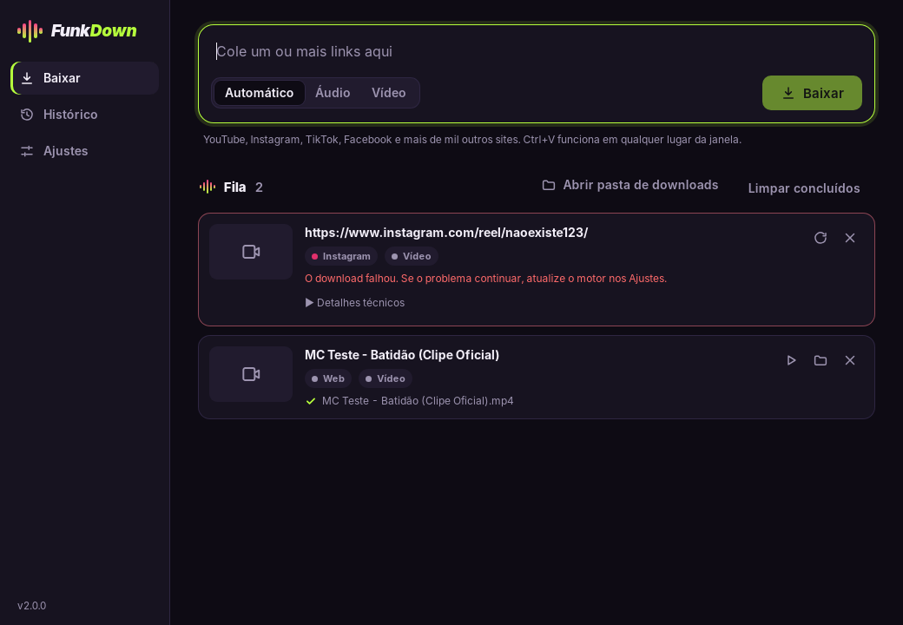

# FunkDown

Baixe músicas e vídeos do YouTube, Instagram, TikTok, Facebook e de qualquer outro site que o [yt-dlp](https://github.com/yt-dlp/yt-dlp) suporte. Cole o link e o app decide sozinho: áudio no YouTube, vídeo nas redes sociais.



FunkDown é a versão 2 do antigo YTFunkDown, reescrita em Rust com [Tauri 2](https://tauri.app) e Svelte 5. O app original em Python continua em [`legacy/`](legacy/).

> Baixe apenas conteúdo que você tem o direito de baixar. Respeite os direitos autorais e os termos de uso de cada plataforma.

## O que ele faz

- **Fila de downloads** com vários links de uma vez, até 5 simultâneos, progresso, cancelar e tentar de novo por item.
- **Áudio ou vídeo**: MP3 ou M4A (128, 192 ou 320 kbps) e MP4 até a qualidade máxima. Até 1080p o app prefere H.264 + AAC, que abre em qualquer celular e no WhatsApp.
- **Nomes e tags limpos**: `Artista - Título.mp3` com acentos, capa quadrada e tags de artista e título gravadas no arquivo.
- **Playlists do YouTube** em subpasta própria, numeradas, com limite configurável.
- **Recorte de trecho**: baixe só de `0:30` a `1:15`, por exemplo.
- **Login sem senha**: para conteúdo que exige conta, o yt-dlp lê os cookies de um navegador onde você já está logado, ou de um arquivo `cookies.txt`.
- **Histórico local** com busca, "abrir", "mostrar na pasta" e "baixar de novo".
- **Erros que explicam o problema** (precisa de login, conteúdo privado, limite de requisições) em vez do erro cru.
- Português e inglês, tema claro e escuro, colar com Ctrl+V em qualquer lugar da janela e arrastar links.
- Opcional: cortar trechos sem música de clipes com o SponsorBlock.

## Instalação

Baixe o instalador da [última release](https://github.com/GianFadiga/FunkDown/releases/latest):

| Sistema | Arquivo |
| --- | --- |
| Windows 10/11 | `FunkDown_x.y.z_x64-setup.exe` |
| Linux (qualquer distro) | `FunkDown_x.y.z_amd64.AppImage` |
| Debian/Ubuntu | `FunkDown_x.y.z_amd64.deb` |

**Windows e o SmartScreen.** O instalador não tem assinatura de código paga, então o Windows mostra "O Windows protegeu o computador" na primeira vez. Clique em **Mais informações** e depois em **Executar assim mesmo**.

**Primeira execução.** O app baixa o motor (yt-dlp, FFmpeg e Deno, cerca de 300 MB em disco no Windows) dos releases oficiais no GitHub e confere o SHA-256 de cada arquivo antes de usar. No Linux, se já houver `ffmpeg` e `deno` no sistema, eles são aproveitados.

## Privacidade

- **Zero telemetria.** O app só se conecta ao site do link que você colou e ao GitHub (motor e atualizações).
- **Nenhuma senha passa pelo app.** Os cookies do navegador são lidos pelo yt-dlp só na hora do download e nunca são copiados nem salvos. Do `cookies.txt`, o app guarda só o caminho.
- **Histórico e ajustes ficam em arquivos locais.** O histórico pode ser limpo ou desligado nos Ajustes.
- O SponsorBlock consulta um serviço de terceiros e por isso vem desligado.

## Segurança

- yt-dlp, FFmpeg e Deno são verificados por SHA-256 contra o checksum publicado em cada release.
- O link é validado (só `http`/`https`) e passado ao yt-dlp depois de `--`, sem shell, então nunca é lido como opção.
- A interface não tem acesso direto a arquivos: abrir e mostrar downloads passa por comandos Rust que só aceitam o id de um download feito pelo próprio app.
- CSP restrita, permissões mínimas do Tauri, `cargo audit`, `npm audit` e Dependabot no CI.

## Desenvolvimento

Pré-requisitos: [Rust](https://rustup.rs), Node.js 22+ e as [dependências do Tauri](https://tauri.app/start/prerequisites/) para o seu sistema.

```bash
npm install
npm run tauri dev      # app com recarga automática
npm run tauri build    # instaladores em target/release/bundle/
```

Testes e verificações:

```bash
cargo test -p funkdown-core                       # núcleo
cargo clippy --workspace --all-targets -- -D warnings
npm run check                                     # tipos da interface
```

O núcleo também roda sem interface, usando o `yt-dlp` e o `ffmpeg` do PATH:

```bash
cargo run -p funkdown-core --example fdl -- --audio --out musicas "https://..."
```

### Estrutura

```
crates/funkdown-core/   núcleo em Rust, sem dependência de interface
  platform.rs           validação de links e detecção de plataforma
  args.rs               linha de comando do yt-dlp (função pura)
  progress.rs           leitura do progresso e dos metadados
  queue.rs              fila, concorrência, cancelamento
  engine.rs             download verificado do yt-dlp, FFmpeg e Deno
  error.rs              tradução dos erros do yt-dlp
  history.rs settings.rs
src-tauri/              casca Tauri: comandos e eventos
src/                    interface em Svelte 5 + TypeScript
docs/SPEC.md            decisões de projeto e próximos passos
docs/RELEASE.md         como publicar uma versão
legacy/                 YTFunkDown v1 (Python + Tkinter)
```

## Limitações conhecidas

- No Windows, Chrome, Edge e Brave bloqueiam a leitura de cookies por outros programas. Para login, use o Firefox ou um `cookies.txt`.
- O recorte quadrado da capa só acontece quando a miniatura precisa ser convertida (no YouTube, quase sempre). Uma miniatura que já vem em JPG fica no formato original.
- Perfis inteiros do Instagram e do TikTok não são suportados de propósito: é o caso que mais leva a bloqueio de conta.

## Licença

[MIT](LICENSE). O FunkDown usa o yt-dlp (Unlicense), o FFmpeg (GPL, binário separado) e o Deno (MIT) sem modificá-los.
